  

# 📈 Awesome Sales Forecasting & Revenue Intelligence

  

> 🚀 A curated collection of state-of-the-art **Sales Forecasting**, **Revenue Intelligence**, and **Pipeline Analytics** software platforms, machine learning models, and open-source tools.

Track premier SaaS platforms and open-source GitHub repositories for predictive deal pipeline forecasting, B2B sales conversation intelligence, deal slippage detection, and self-hosted revenue operations analytics. 🎯💼

---

## 📑 Table of Contents

- [🌐 Sector Overview & Market Dynamics](#-sector-overview--market-dynamics)
- [🏢 SaaS & Hosted Platforms](#-saas--hosted-platforms)
- [💻 Open-Source GitHub Projects](#-open-source-github-projects)
- [🏗️ Key Architectural & Implementation Patterns](#️-key-architectural--implementation-patterns)
- [🤝 How to Contribute](#-how-to-contribute)
- [💖 Support & Sponsorship](#-support--sponsorship)
- [📊 Star History](#-star-history)
- [⚖️ Disclaimer & License](#️-disclaimer--license)

---

## 🌐 Sector Overview & Market Dynamics

The global Revenue Intelligence and Sales Forecasting software market is valued at approximately **$4.2B to $4.5B** and is projected to expand past **$10.7B to $18B+ by 2030** (growing at an 11%–15% CAGR), propelled by autonomous AI revenue agents, LLM-based call reasoning, and predictive time-series models. 📊 

Structurally, the ecosystem exhibits a **hybrid concentration**: the upper market is heavily concentrated around dominant CRM anchors and multi-billion-dollar enterprise suites (Salesforce, HubSpot, Gong, and Clari) that hold captive CRM data, while the lower and mid tiers remain moderately fragmented with specialized point solutions competing across conversational analysis, real-time rep guidance, and niche statistical forecasting. 🔄✨

---

## 🏢 SaaS & Hosted Platforms

The table below catalogs top SaaS sales forecasting and revenue intelligence platforms, sorted in descending order by estimated company size (market capitalization / enterprise valuation):

| Product | 🏢 Company Size (Valuation / Revenue) | 🏷️ Starting Pricing (Specific Tier) | ⏳ Free Tier / Trial Limit | 💡 Key Focus & Capabilities |
| :--- | :--- | :--- | :--- | :--- |
| **[Salesforce Sales Cloud](https://www.salesforce.com/products/sales-cloud/)** (Einstein Forecasting) | ~$280B+ Market Cap (~$41.5B Revenue) | **$25 / user / month** (*Starter Suite* tier; Enterprise at $175/user/mo, Einstein 1 at $500/user/mo) | **30-day free trial** (Full platform trial access without credit card; no permanent free plan) | CRM market leader featuring Einstein AI predictive pipeline analysis, deal opportunity scoring, and activity forecasting. |
| **[HubSpot Sales Hub](https://www.hubspot.com/products/sales)** (Predictable AI) | ~$30B+ Market Cap (~$3.1B Revenue) | **$20 / user / month** (*Starter* tier; Professional with AI Forecasting at $100/user/mo) | **Free Forever Plan** (Capped at 2 user seats, 1 deal pipeline, 1,000 contacts; no native AI forecasting) | Inbound CRM and sales execution platform integrating native pipeline forecasting, rep task tracking, and conversation summaries. |
| **[Gong](https://www.gong.io/)** | ~$7.25B Valuation (~$500M+ ARR) | **$100 / user / month** (Base license, billed annually; plus ~$5,000/yr platform fee) | **0 days** (No self-serve free trial or free tier; proof of concept and demos via enterprise sales only) | Benchmark conversation intelligence and revenue AI engine recording calls, tracking buying signals, and scoring deal health. |
| **[Clari](https://www.clari.com/)** | ~$2.6B Valuation (~$250M+ ARR) | **$100 / user / month** (Core forecasting module, billed annually; platform base minimum applies) | **0 days** (No free trial or free tier available; custom enterprise pilots scoped via sales team) | Enterprise revenue platform aggregating CRM, email, calendar, and call interactions for predictive pipeline governance. |
| **[Salesloft](https://salesloft.com/)** | ~$2.3B Valuation (~$200M+ ARR) | **$125 / user / month** (Advanced sales engagement tier, billed annually) | **0 days** (No self-serve free trial or free tier; gated behind customized enterprise demo cycles) | Sales execution and revenue orchestration suite combining cadences, buyer engagement tracking, and pipeline deal forecasting. |
| **[Troops](https://www.troops.ai/)** | ~$100M+ Acquisition (Acquired by Salesforce) | **$60 / user / month** (Integrated as Slack Sales Elevate in Salesforce) | **30-day free trial** (Available via Slack/Salesforce ecosystem trial; standalone product discontinued) | Workflow and revenue signal automation tool pushing pipeline inspection, forecast updates, and deal alerts into Slack. |
| **[Revenue.io](https://www.revenue.io/)** | ~$100M+ Est. Valuation (Goldman Sachs backed) | **$75 / user / month** (*Activate* tier dialer & guidance; *Engage* at $120/user/mo) | **0 days** (No self-serve free tier for core suite; selective free trial offered only for *Revenue Roleplay* add-on) | Real-time conversation guidance, AI sales dialer, pipeline inspection, and automated Salesforce CRM forecasting. |
| **[BoostUp.ai](https://www.boostup.ai/)** (Terret) | ~$50M–$100M Est. Valuation ($43M+ Funding) | **$51 / user / month** (Base revenue intelligence package, billed annually) | **0 days** (No out-of-the-box self-serve free trial; custom 14-day vendor-assisted pilots by request) | RevOps platform delivering predictive forecasting, risk scoring, multi-tier pipeline rollups, and activity capture. |
| **[Aviso](https://www.aviso.com/)** | ~$50M–$80M Est. Valuation ($46M+ Funding) | **$40 / user / month** (Entry enterprise module; full suite scales to $100/user/mo) | **14-day pilot / trial** (Vendor-assisted structured evaluation period upon enterprise qualification; no public free plan) | AI-driven revenue intelligence with multi-quarter forecasting, automated CRM hygiene, and Win/Loss opportunity grading. |
| **[InsightSquared](https://www.insightsquared.com/)** (Mediafly) | ~$40M–$60M Est. Valuation ($60M+ Raised) | **$51 / user / month** (Baseline RevOps tier, billed annually) | **0 days** (No self-serve free trial or freemium tier; scheduled guided sandbox demonstrations only) | Revenue analytics and forecasting dashboard providing historical pipeline pacing, win-rate analysis, and coaching metrics. |

---

## 💻 Open-Source GitHub Projects

The table below lists community and open-source sales forecasting engines, revenue intelligence scripts, and demand prediction models, sorted in descending order by GitHub stargazers count:

| Repository | ⭐ GitHub Stars | 🛠️ Primary Language / Stack | 🔍 Architecture & Description |
| :--- | :--- | :--- | :--- |
| **[LenzDu / Kaggle-Competition-Favorita](https://github.com/LenzDu/Kaggle-Competition-Favorita)** |  | Python / GBDT / NNs | 5th place world solution for large-scale grocery retail sales forecasting utilizing gradient boosted decision trees and neural networks. |
| **[davidthaler / Walmart_competition_code](https://github.com/davidthaler/Walmart_competition_code)** |  | R / Time Series | Production-proven 1st place solution for the Walmart store and department sales forecasting competition featuring complex seasonal adjustments. |
| **[mollyryanruby / sales_forecasting](https://github.com/mollyryanruby/sales_forecasting)** |  | Python / Jupyter | Benchmarking suite of 5 machine learning and statistical time-series techniques for multi-horizon product and revenue prediction. |
| **[horilla / horilla-crm](https://github.com/horilla/horilla-crm)** |  | Python / Django / PostgreSQL | Free and open-source CRM (LGPL-2.1) with a dedicated Sales Forecasting module, opportunity stage tracking, and Big Deal Alerts. |
| **[Akajiaku11 / Sales-Forecasting](https://github.com/Akajiaku11/Sales-Forecasting)** |  | Python / Statsmodels / ARIMA | End-to-end sales forecasting pipeline predicting future order revenue using Box-Jenkins ARIMA modeling and residual diagnostics. |
| **[samirsaci / ml-forecast-features-eng](https://github.com/samirsaci/ml-forecast-features-eng)** |  | Python / Scikit-Learn | Enterprise-grade feature engineering pipeline for sales and demand forecasting covering lag variables, rolling stats, and calendar indicators. |
| **[akshitvjain / product-sales-forecasting](https://github.com/akshitvjain/product-sales-forecasting)** |  | Python / Statsmodels | Comparative sales forecasting engine evaluating Holt-Winters exponential smoothing, SARIMA, and Linear Regression via MAE, RMSE, and MAPE. |
| **[30lm32 / ml-time-series-analysis-on-sales-data](https://github.com/30lm32/ml-time-series-analysis-on-sales-data)** |  | Python / Scikit-Learn | Supervised machine learning and time-series analysis framework comparing non-linear models and ARIMA on longitudinal commercial sales data. |
| **[aws-samples / conversation-intelligence-using-aiml-on-aws](https://github.com/aws-samples/conversation-intelligence-using-aiml-on-aws)** |  | Python / AWS Bedrock / CDK | Reference conversation intelligence architecture analyzing call recordings for sentiment, objections, action items, and rep performance. |
| **[AmirhosseinHonardoust / Market-IQ](https://github.com/AmirhosseinHonardoust/Market-IQ)** |  | Python / Streamlit / Prophet | Interactive sales analytics dashboard pairing SQL-driven data pipelines with Meta Prophet to forecast multi-month sales revenue with confidence bands. |
| **[LazyIsEfficient / agentic-os](https://github.com/LazyIsEfficient/agentic-os)** |  | Python / Shell | Gong-to-Insight intelligence pipeline extracting objections, buying signals, competitor mentions, and multi-touch content revenue attribution. |
| **[DjangoCRM / DjangoCRM](https://github.com/DjangoCRM/DjangoCRM)** |  | Python / Django / MySQL | Enterprise open-source CRM featuring sales analytics funnels, deal management, and built-in monthly/quarterly revenue forecast reports. |
| **[GeekYasuo / ai-business-intelligence-platform](https://github.com/GeekYasuo/ai-business-intelligence-platform)** |  | React / TypeScript / Python | AI-powered enterprise BI stack supporting ML revenue and churn forecasting, natural language querying, and Isolation Forest anomaly detection. |
| **[Auspicious14 / ledgermind-ai](https://github.com/Auspicious14/ledgermind-ai)** |  | Next.js / Prisma / Claude AI | Self-hosted revenue intelligence dashboard delivering 30-day linear regression forecasting, Z-score revenue anomaly detection, and AI audit summaries. |
| **[badrr06 / SalesIq](https://github.com/badrr06/SalesIq)** |  | Python / Flask / Chart.js | Lightweight web-based sales inventory tracking and 6-month ARIMA/Linear Regression revenue forecasting platform with SQLite/MySQL backends. |

---

## 🏗️ Key Architectural & Implementation Patterns

1. **Transactional vs. Pipeline Forecasting**:
   - **Pipeline-Based (B2B SaaS / High ACV)**: Models deal stages, probability percentages, historical close velocities, slippage rates, and rep bias (e.g., Salesforce Einstein, Clari, BoostUp).
   - **Transaction-Based (Retail / E-Commerce / Low ACV)**: Evaluates high-frequency historical transactions, seasonality cycles, autoregressive lags, and promotional calendar features using statistical and machine learning models (e.g., ARIMA, Prophet, LightGBM, Holt-Winters).
2. **Conversation Intelligence Pipeline**:
   - Audio ingestion $\rightarrow$ Automatic Speech Recognition (ASR / Whisper) $\rightarrow$ Speaker Diarization $\rightarrow$ LLM entity and intent classification (extracting pricing queries, budget indicators, decision-maker hurdles, and competitive mentions).
3. **Anomaly Detection & Revenue Leakage**:
   - Statistical thresholds (Z-score variations exceeding $2.5\sigma$) and unsupervised isolation models (Isolation Forest, Autoencoders) to catch sudden drops in closed-won velocity or unexpected margin erosions.

---

## 🤝 How to Contribute

1. Fork this repository. 🍴
2. Add new tools, models, or repos to `README.md` following the standard tabular format. 📝
3. Verify that all open-source projects include functional repo links and all SaaS solutions include factual pricing/trial details. 🔍
4. Open a pull request with a concise description of your additions. 🚀

---

## 💖 Support & Sponsorship

Thank you so much for exploring and using this repository! If this curated ecosystem guide helps your team optimize pipeline predictability or evaluate revenue platforms, please consider supporting the project:

- ⭐ **Star this repository** to help others discover it on GitHub.
- 🍴 **Fork and contribute** your favorite open-source tools or insights.
- 📢 **Share it** with your RevOps, data science, and sales engineering colleagues.
- ☕ **Buy a coffee or sponsor the project**: Support ongoing maintenance and curated research via the [GitHub Sponsors Dashboard](https://github.com/sponsors/ishandutta2007).

Your support is deeply appreciated! 🙌

---

## 📊 Star History

---

## ⚖️ Disclaimer & License

- This list is community-curated for informational purposes; always verify terms, SOC-2/GDPR compliance, and licensing before production deployment. 🛡️
- Released under the [MIT License](https://github.com/ishandutta2007/Awesome-Awesome-Awesome). 📄
